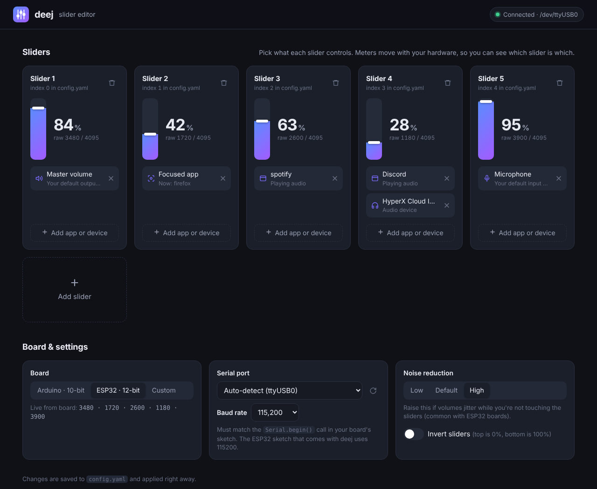

# deej

deej is an **open-source hardware volume mixer** for Windows and Linux PCs. It lets you use real-life sliders (like a DJ!) to **seamlessly control the volumes of different apps** (such as your music player, the game you're playing and your voice chat session) without having to stop what you're doing.

**Join the [deej Discord server](https://discord.gg/nf88NJu) if you need help or have any questions!**

[](https://discord.gg/nf88NJu)

> **_New:_** [work-in-progress deej FAQ](./docs/faq/faq.md)!

> **_This fork:_** everything that used to be Windows-only now works on Linux too (controlling the focused app, binding devices by name, system sounds), plus [ESP32 support](#esp32-boards) and a [slider editor](#slider-editor) you can use instead of editing `config.yaml` by hand. See [Linux notes](#linux-notes) for setup details.

deej consists of a [lightweight desktop client](#features) written in Go, and an Arduino-based hardware setup that's simple and cheap to build. [**Check out some versions built by members of our community!**](./community.md)

**[Download the latest release](https://github.com/omriharel/deej/releases/latest) | [Video demonstration](https://youtu.be/VoByJ4USMr8) | [Build video by Tech Always](https://youtu.be/x2yXbFiiAeI)**


> _**Psst!** [No 3D printer? No problem!](./assets/build-shoebox.jpg)_ You can build deej on some cardboard, a shoebox or even a breadboard :)

## Table of contents

- [Features](#features)
- [How it works](#how-it-works)
  - [Hardware](#hardware)
    - [Schematic](#schematic)
  - [Software](#software)
- [Slider mapping (configuration)](#slider-mapping-configuration)
  - [Slider editor](#slider-editor)
- [Build your own!](#build-your-own)
  - [FAQ](#faq)
  - [Build video](#build-video)
  - [Bill of Materials](#bill-of-materials)
  - [Thingiverse collection](#thingiverse-collection)
  - [Build procedure](#build-procedure)
  - [ESP32 boards](#esp32-boards)
- [How to run](#how-to-run)
  - [Requirements](#requirements)
  - [Download and installation](#download-and-installation)
  - [Building from source](#building-from-source)
  - [Linux notes](#linux-notes)
- [Community](#community)
- [License](#license)

## Features

deej is written in Go and [distributed](https://github.com/omriharel/deej/releases/latest) as a portable (no installer needed) executable.

- Bind apps to different sliders
  - Bind multiple apps per slider (i.e. one slider for all your games)
  - Bind the master channel
  - Bind "system sounds" (notification and alert sounds on Linux)
  - Bind specific audio devices by name
  - Bind currently active app
  - Bind all other unassigned apps
- Control your microphone's input level
- A [slider editor](#slider-editor) that shows your sliders moving live, and lets you pick apps and devices from a list
- Works with Arduino and [ESP32](#esp32-boards) boards, and finds your board's serial port on its own
- Reconnects automatically when you unplug and re-plug your board
- Lightweight desktop client, consuming around 10MB of memory
- Runs from your system tray
- Helpful notifications to let you know if something isn't working

> **Looking for the older Python version?** It's no longer maintained, but you can always find it in the [`legacy-python` branch](https://github.com/omriharel/deej/tree/legacy-python).

## How it works

### Hardware

- The sliders are connected to 5 (or as many as you like) analog pins on an Arduino Nano/Uno board. They're powered from the board's 5V output (see schematic)
- The board connects via a USB cable to the PC

#### Schematic


### Software

- The code running on the Arduino board is a [C program](./arduino/deej-5-sliders-vanilla/deej-5-sliders-vanilla.ino) constantly writing current slider values over its serial interface
- The PC runs a lightweight [Go client](./pkg/deej/cmd/main.go) in the background. This client reads the serial stream and adjusts app volumes according to the given configuration file

## Slider mapping (configuration)

deej uses a simple YAML-formatted configuration file named [`config.yaml`](./config.yaml), placed alongside the deej executable.

The config file determines which applications (and devices) are mapped to which sliders, and which parameters to use for the connection to the Arduino board, as well as other user preferences.

**This file auto-reloads when its contents are changed, so you can change application mappings on-the-fly without restarting deej.** If it doesn't exist yet, deej creates one with default settings.

You can also skip editing it by hand and use the [slider editor](#slider-editor) instead.

It looks like this:

```yaml
slider_mapping:
  0: master
  1: chrome.exe
  2: spotify.exe
  3:
    - pathofexile_x64.exe
    - rocketleague.exe
  4: discord.exe

# set this to true if you want the controls inverted (i.e. top is 0%, bottom is 100%)
invert_sliders: false

# settings for connecting to the arduino/esp board
# use 'auto' to pick the first usb serial device, or a port name like COM4 (windows), /dev/ttyUSB0 or /dev/serial/by-id/... (linux)
com_port: auto
baud_rate: 9600

# the highest value your board sends for a slider: 1023 for arduino boards (10-bit), 4095 for ESP32 boards (12-bit)
slider_max_value: 1023

# adjust the amount of signal noise reduction depending on your hardware quality
# supported values are "low" (excellent hardware), "default" (regular hardware) or "high" (bad, noisy hardware)
noise_reduction: default
```

- `master` is a special option to control the master volume of the system _(uses the default playback device)_
- `mic` is a special option to control your microphone's input level _(uses the default recording device)_
- `deej.unmapped` is a special option to control all apps that aren't bound to any slider ("everything else")
- `deej.current` is a special option to control whichever app is currently in focus (on Linux, see [which desktops are supported](#controlling-the-focused-app-deejcurrent))
- You can specify a device's full name to bind that device's level to a slider. This doesn't conflict with the default `master` and `mic` options, and works for both input and output devices.
  - On Windows, that's the name seen in the menu that comes up when left-clicking the speaker icon in the tray menu, i.e. `Speakers (Realtek High Definition Audio)`
  - On Linux, that's the name seen in your sound settings (or `pavucontrol`), i.e. `Built-in Audio Analog Stereo`
  - The slider editor lists all of your devices, so you don't have to type them out
- `system` is a special option to control system sounds: the "System sounds" volume in the Windows mixer, or notification and alert sounds on Linux
- All names are case-**in**sensitive, meaning both `chrome.exe` and `CHROME.exe` will work
- On Windows, app names include `.exe` (`chrome.exe`), while on Linux they don't (`chrome`). The slider editor lists the apps that are currently playing audio by the name deej knows them by
- You can create groups of process names (using a list) to either:
    - control more than one app with a single slider
    - choose whichever process in the group that's currently running (i.e. to have one slider control any game you're playing)

### Slider editor

Right-click deej's tray icon and choose **Open slider editor**, or open [http://localhost:3335](http://localhost:3335) in your browser while deej is running.



- Each slider's meter moves along with your hardware, so it's easy to tell which slider is which
- Click **Add app or device** to pick from the apps currently playing audio, your audio devices, or the special options above. You can also type in the name of an app that isn't running right now
- The settings below the sliders cover the rest of `config.yaml`: your board type, serial port (with a list of the ones deej can see), baud rate, noise reduction and inverted sliders
- Saving writes `config.yaml` (keeping the previous version as `config.yaml.bak`), and deej applies the changes right away. Comments are rewritten with a fresh copy of the documentation above, and settings the editor doesn't know about are kept
- The editor only listens on your own computer (`localhost`), and only answers requests from its own page

## Build your own!

Building deej is very simple. You only need a few relatively cheap parts - it's an excellent starter project (and my first Arduino project, personally). Remember that if you need any help or have a question that's not answered here, you can always [join the deej Discord server](https://discord.gg/nf88NJu).

Build deej for yourself, or as an awesome gift for your gaming buddies!

### FAQ

I've started a highly focused effort of writing a proper FAQ page for deej, covering many basic and advanced topics.

It is still _very much a work-in-progress_, but I'm happy to [share it in its current state](./docs/faq/faq.md) in hopes that it at least covers some questions you might have.

FAQ feedback in our [community Discord](https://discord.gg/nf88NJu) is strongly encouraged :)

### Build video

In case you prefer watching to reading, Charles from the [**Tech Always**](https://www.youtube.com/c/TechAlways) YouTube channel has made [**a fantastic video**](https://youtu.be/x2yXbFiiAeI) that covers the basics of building deej for yourself, including parts, costs, assembly and software. I highly recommend checking it out!

### Bill of Materials

- An Arduino Nano, Pro Micro or Uno board
  - I officially recommend using a Nano or a Pro Micro for their smaller form-factor, friendlier USB connectors and more analog pins. Plus they're cheaper
  - You can also use any other development board that has a Serial over USB interface
- A few slider potentiometers, up to your number of free analog pins (the cheaper ones cost around 1-2 USD each, and come with a standard 10K Ohm variable resistor. These _should_ work just fine for this project)
  - **Important:** make sure to get **linear** sliders, not logarithmic ones! Check the product description
  - You can also use circular knobs if you like
- Some wires
- Any kind of box to hold everything together. **You don't need a 3D printer for this project!** It works fantastically with just a piece of cardboard or a shoebox. That being said, if you do have one, read on...

### Thingiverse collection

With many different 3D-printed designs being added to our [community showcase](./community.md), it felt right to gather all of them in a Thingiverse collection for you to browse. If you have access to a 3D printer, feel free to use one of the designs in your build.

**[Visit our community-created design collection on Thingiverse!](https://thingiverse.com/omriharel/collections/deej)**

> You can also [submit your own](https://discord.gg/nf88NJu) design to be added to the collection. Regardless, if you do upload your design to Thingiverse, _please add a `deej` tag to it so that others can find it more easily_.


### Build procedure

- Connect everything according to the [schematic](#schematic)
- Test with a multimeter to be sure your sliders are hooked up correctly
- Flash the Arduino chip with the sketch in [`arduino\deej-5-sliders-vanilla`](./arduino/deej-5-sliders-vanilla/deej-5-sliders-vanilla.ino)
  - _Important:_ If you have more or less than 5 sliders, you must edit the sketch to match what you have
- After flashing, check the serial monitor. You should see a constant stream of values separated by a pipe (`|`) character, e.g. `0|240|1023|0|483`
  - When you move a slider, its corresponding value should move between 0 and 1023
- Congratulations, you're now ready to run the deej executable!

### ESP32 boards

ESP32 boards work great with deej, and have plenty of analog pins. A few things are different from an Arduino, though:

- Flash the sketch in [`arduino/deej-esp32`](./arduino/deej-esp32/deej-esp32.ino) instead. It averages and smooths readings, since the ESP32's analog inputs are a lot noisier
- **Power your sliders from the 3.3V pin, never 5V/VIN** - ESP32 pins aren't 5V tolerant
- Only use ADC1 pins (GPIO 32-39 on the classic ESP32). ADC2 pins stop working whenever wifi is on. The sketch lists pin suggestions for the S2, S3 and C3 variants too
- ESP32 readings go from 0 to 4095 (instead of 1023), and the sketch talks at 115200 baud. So set `slider_max_value: 4095` and `baud_rate: 115200` in your config, or just pick **ESP32 · 12-bit** in the slider editor. If you forget, deej notices and lets you know
- If volumes still jitter while you're not touching the sliders, set `noise_reduction: high`
- On Linux, ESP32 boards show up as `/dev/ttyUSB0` (boards with a CP2102 or CH340 USB chip) or `/dev/ttyACM0` (boards with native USB, like the S2/S3). `com_port: auto` finds either one
- ESP8266 boards only have a single analog pin, so you'd need an analog multiplexer (like the CD4051) to use more than one slider

## How to run

### Requirements

#### Windows

- Windows. That's it

#### Linux

- PulseAudio, or PipeWire with `pipewire-pulse` (the default on most current distros)
- Permission to use serial ports - see [Linux notes](#linux-notes)
- Pre-built Linux binaries aren't currently released, so you'll need to [build from source](#building-from-source). No extra libraries are needed for the tray icon anymore

### Download and installation

- Head over to the [releases page](https://github.com/omriharel/deej/releases) and download the [latest version](https://github.com/omriharel/deej/releases/latest)'s executable and configuration file (`deej.exe` and `config.yaml`)
- Place them in the same directory anywhere on your machine
- (Optional, on Windows) Create a shortcut to `deej.exe` and copy it to `%APPDATA%\Microsoft\Windows\Start Menu\Programs\Startup` to have deej run on boot

### Building from source

If you'd rather not download a compiled executable, or want to extend deej or modify it to your needs, feel free to clone the repository and build it yourself. All you need is a Go 1.21 (or above) environment on your machine. If you go this route, make sure to check out the [developer scripts](./pkg/deej/scripts).

On Linux, that's just:

```sh
git clone https://github.com/Wizard815/deej-Linux.git
cd deej-Linux
./pkg/deej/scripts/linux/build-release.sh   # creates ./deej-release
cp config.yaml deej-release /somewhere/you/like/
```

Run deej from the directory that has its `config.yaml`, since that's where it looks for it.

Like other Go packages, you can also use the `go get` tool: `go get -u github.com/omriharel/deej`. Please note that the package code now resides in the `pkg/deej` directory, and needs to be imported from there if used inside another project.

If you need any help with this, please [join our Discord server](https://discord.gg/nf88NJu).

### Linux notes

#### Serial port permissions

Most distros only let members of a certain group use serial ports. If deej tells you it doesn't have permission to open your board's port, add yourself to that group and log out and back in:

```sh
sudo usermod -aG dialout $USER   # Debian, Ubuntu, Fedora, openSUSE...
sudo usermod -aG uucp $USER      # Arch, Manjaro, EndeavourOS...
```

If your board isn't plugged in when deej starts (or you unplug it later), deej waits for it and connects as soon as it's back.

#### Tray icon

The tray icon uses the standard StatusNotifierItem protocol, which works out of the box on KDE Plasma and most desktops with a system tray. On GNOME, install the [AppIndicator and KStatusNotifierItem Support](https://extensions.gnome.org/extension/615/appindicator-support/) extension (Ubuntu ships it already). Without a tray, deej still runs normally, and the slider editor is always at [http://localhost:3335](http://localhost:3335).

#### Controlling the focused app (`deej.current`)

Linux has no single way to ask which window is focused, so deej supports each of these:

| Desktop | Works? |
| --- | --- |
| Any X11 session (GNOME, KDE, XFCE, Cinnamon, i3...) | Yes |
| KDE Plasma 5/6 (Wayland) | Yes - deej loads a tiny KWin script to follow the focused window |
| Hyprland, Sway, niri | Yes |
| GNOME (Wayland) | With the [Window Calls](https://extensions.gnome.org/extension/4724/window-calls/) extension. Without it, only apps running through XWayland (like most games) are detected, and deej lets you know |

The focused app's whole process tree counts, so a game launched from a terminal or Steam is found even when its audio comes from a child process.

#### System sounds (`system`)

On Linux, `system` controls notification and alert sounds (streams with the `event` media role, like the ones GNOME and KDE play). Since these sounds are short, deej applies the slider's volume the moment one starts playing (and most sound servers remember that volume for the next one).

#### Starting deej on login

Create `~/.config/autostart/deej.desktop` (adjust the path to where you put deej):

```ini
[Desktop Entry]
Type=Application
Name=deej
Exec=sh -c 'cd "$HOME/deej" && ./deej-release'
X-GNOME-Autostart-enabled=true
```

## Community

[](https://discord.gg/nf88NJu)

deej is a relatively new project, but a vibrant and awesome community is rapidly growing around it. Come hang out with us in the [deej Discord server](https://discord.gg/nf88NJu), or check out a whole bunch of cool and creative builds made by our members in the [community showcase](./community.md).

The server is also a great place to ask questions, suggest features or report bugs (but of course, feel free to use GitHub if you prefer).

### Donations

If you love deej and want to show your support for this project, you can do so using the link below. Please don't feel obligated to donate - building the project and telling your friends about it goes a very long way! Thank you very much.

[](https://ko-fi.com/omriharel)

### Contributing

Please see [`docs/CONTRIBUTING.md`](./docs/CONTRIBUTING.md).

## License

deej is released under the [MIT license](./LICENSE).
